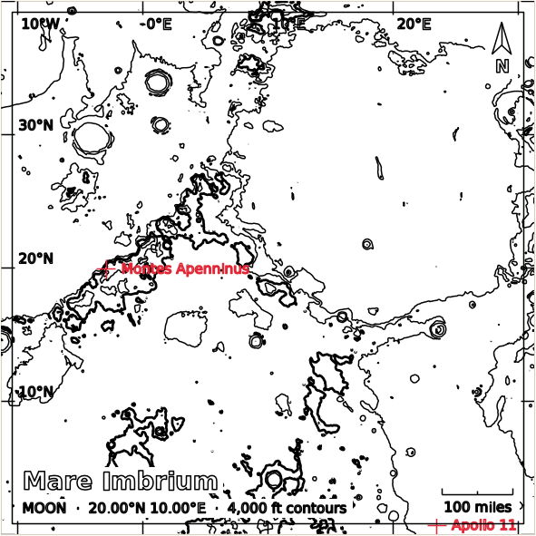
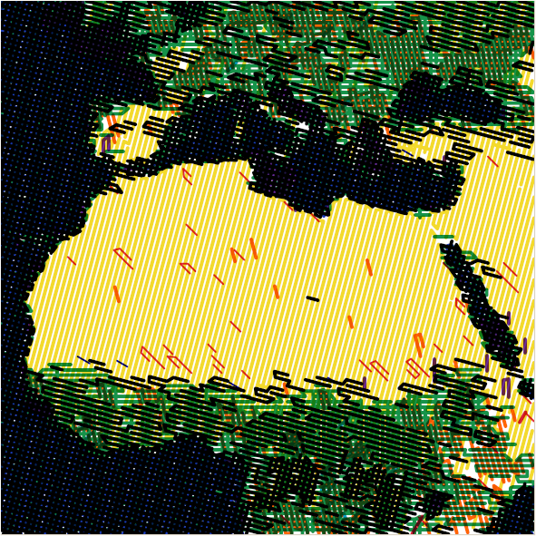
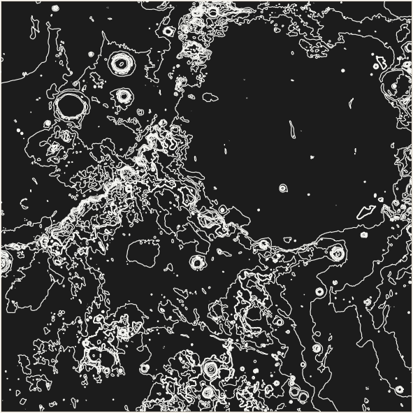
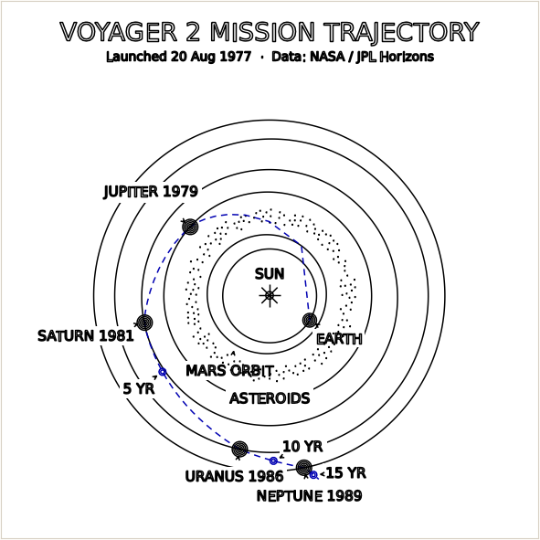

# Topo Plotter Studio (Cartographer Edition)

A desktop app that turns elevation data and colour maps of the **Earth, Moon and Mars**, spacecraft
trajectories through the **Solar System**, and your own **images** into multi-pen G-code for a
**pen plotter**. It was built for a Creality Ender 3 converted to hold a pen (Marlin firmware), but the
output is plain G-code and SVG, so it can be adapted to other machines.

<p align="center">
  
  
  
  
</p>
<p align="center"><sub>Plot previews rendered by the app: lunar contours with map furniture, a colour hatch fill
using real pen colours, white pen on black paper, and Voyager 2's path from NASA JPL data.</sub></p>

## What it does

- **Topographic contours** from global or regional elevation models: automatic contour interval, index
  lines, smoothing and simplification, and illuminated (Tanaka) contours.
- **Hatching and stippling fills** shaded by the colour map, a computed hillshade, or both: crosshatch,
  variable-spacing scanlines, sine squiggles, stipple dots, and slope hachures.
- **Colour separation with the pens you own.** Tick the pens that are in stock and pick the paper colour,
  including black or coloured construction paper with opaque white gel pens. The app chooses a mix of
  your inks for each tone and previews it in true pen colours and line widths.
- **Map furniture** in single-stroke plotter lettering: title block, scale bar (miles or km), north arrow,
  coordinate grid and frame. Map lines are blanked behind the text.
- **Points of interest** for each body, such as Apollo landing sites, Olympus Mons and Lake Tahoe, with
  labels you can plot.
- **Sharper regional data on demand.** Fetch 30 m Copernicus elevation, Sentinel-2 or USGS aerial colour,
  59 m lunar or 200 m Martian elevation for just the area you selected. You can also import any GeoTIFF.
- **Solar System mode.** Plot real trajectories of 17 deep-space missions (Voyager, Pioneer, Cassini,
  New Horizons, Juno, Parker Solar Probe and more), downloaded from NASA JPL Horizons, on a compressed
  scale with orbits, year markers, labels and a stippled asteroid belt.
- **Image tracing.** Trace logos and clip-art into clean colour outlines, with optional hatch fill and an
  offset sticker cut line. Photos can be turned into edge drawings.
- **Hand edits.** Paint strokes with a different pen, draw lines, add and rotate text, and recolour a
  whole layer from a right-click menu, with undo and redo.
- **Plotter-ready export.** You get one G-code file per pen, or one combined file that pauses (`M0`) for
  pen swaps. Strokes are optimised with [vpype](https://github.com/abey79/vpype). The app adds safe pen
  lifts, warns about bed limits, and estimates plot time. SVG export is also available.
- **Projects and presets.** Save and reopen everything: area, styles, pens, edits and annotations.

## Quick start

You need **Windows**, **Python 3.12** and Git.

```bash
git clone https://github.com/natemcoleman/MoonPlotter.git
cd MoonPlotter
python -m venv .venv
.venv\Scripts\activate
pip install -r requirements.txt
python MoonPlotter\main.py
```

The app opens on the **Moon**, whose data comes with the repository, so you can plot straight away.
**The global Earth elevation model is not included** because it is too large for GitHub. When you select
Earth without it, the app explains where to get it. To download it ahead of time:

1. Get the ETOPO 2022 60 arc-second **ice surface** GeoTIFF from
   [NOAA](https://www.ncei.noaa.gov/products/etopo-global-relief-model)
   (`ETOPO_2022_v1_60s_N90W180_surface.tif`).
2. Save it in the `MoonPlotter/` app folder as **`BE_dem_v2.tif`**. You can also keep its name and change
   the `'Earth'` → `'dem'` entry in `config.py` instead.

Mars needs two large USGS files. See [Data sources](docs/data-sources.md) for these and every other dataset.

### Your first plot

1. The **Moon** is selected under **Source**. On the **Source map**, scroll to zoom and drag a box around an
   area.
2. Click **Draw Map**. The contour interval is chosen automatically.
3. Optionally, turn on **Fill / Hatching** or **Map furniture** and adjust them. The preview updates live.
4. **File › Save SVG…** to look at the result, or **File › Export G-code…** (`Ctrl+E`) for the plotter.
5. Before your first real plot, read [Plotter setup](docs/plotter-setup.md). The pen height and bed
   offsets in `config.py` must match your machine.

## Documentation

| Guide | What's in it |
|---|---|
| [User guide](docs/user-guide.md) | A tour of every panel: source map, contours, fills, map furniture, layers, editing tools, projects and presets |
| [Plotter setup](docs/plotter-setup.md) | Hardware assumptions, coordinate system, pen height and safety settings, the export dialog, running a plot, adapting to other machines |
| [Pens and paper](docs/pens-and-paper.md) | The pen manager, stock tracking, calibration sheets, colour separation, dark and coloured paper |
| [Data sources](docs/data-sources.md) | Files the app expects, where to download them, regional fetch and GeoTIFF import, licences |
| [Solar System mode](docs/solar-system.md) | Mission plots from JPL Horizons: choosing missions, pens and styles, offline caching |
| [Image tracing](docs/image-tracing.md) | Logos, clip-art and photos to outlines; hatch fill; sticker cut lines |
| [Development](docs/development.md) | Code layout, how a render and an export flow, tests, conventions |

## Safety first

A pen plotter is a CNC machine. The G-code homes the printer (`G28`), so the pen must clear the bed
while homing. Then it treats the paper surface as Z = 0. **If `PEN_DOWN_ABOVE_HOME_MM` in `config.py` is
wrong for your pen holder, the pen will either drag on the paper or crash into the bed.** Start with a
small test plot and keep a hand near the power switch. See [Plotter setup](docs/plotter-setup.md).

## Repository layout

```
MoonPlotter/              repository root
├── README.md
├── requirements.txt
├── docs/                 guides and images
└── MoonPlotter/          the application (main.py starts it)
    ├── main.py           Qt window and all UI logic
    ├── config.py         paper sizes, pens, plotter / G-code settings, data file names
    ├── *.py              engines: contours, hatching, decorations, missions, image tracing, export...
    ├── missions/         cached JPL Horizons trajectories
    ├── regions/          downloaded or imported regional rasters (created on demand)
    ├── projects/         saved projects (*.topo.json): the default save and open folder
    └── tests/            unit tests (python tests/test_engines.py)
```

## Licence

The code is released under the [MIT License](LICENSE). The datasets it downloads or includes have their
own terms, listed below and in [Data sources](docs/data-sources.md#licences-and-credits).

## Data credits

The app downloads or uses public datasets. Please credit them when you share plots.

- Earth elevation: NOAA NCEI ETOPO 2022; Copernicus GLO-30 DEM (© DLR e.V. / Airbus, provided under
  COPERNICUS by the European Union and ESA).
- Earth colour: global mosaic (NASA Blue Marble or similar); Sentinel-2 cloudless by EOX IT Services GmbH (contains modified
  Copernicus Sentinel data). **EOX tiles are licensed CC BY-NC-SA 4.0, for non-commercial use only.**
  USGS orthoimagery / NAIP is public domain.
- Moon: NASA Goddard SVS CGI Moon Kit (LRO LOLA elevation, LROC colour); USGS LOLA/Kaguya merge.
- Mars: USGS Astrogeology (MGS MOLA, Viking colour, HRSC/MOLA blend).
- Borders: Natural Earth (public domain).
- Spacecraft trajectories: NASA JPL Horizons System.
- Lettering: Hershey single-stroke fonts, via vpype.
