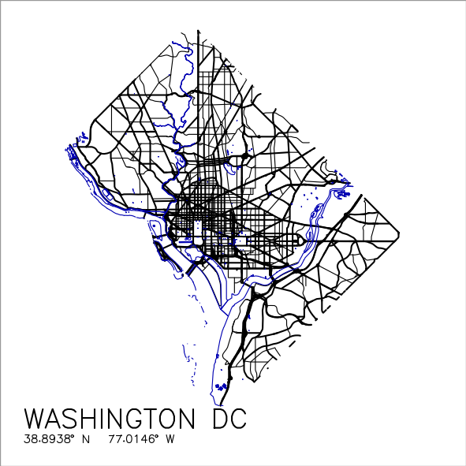
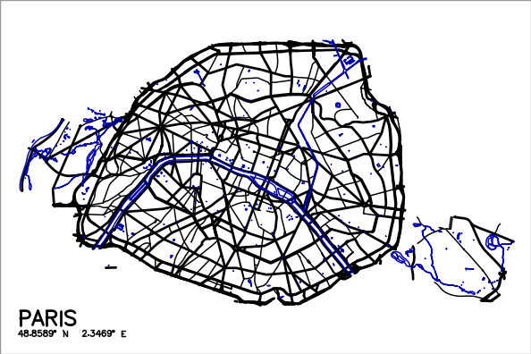

# City road maps

**Source › Subject › City** draws every road of a city as pen lines. The idea comes from Andrei Kashcha's
[city-roads](https://github.com/anvaka/city-roads): roads only, with no labels or buildings. The street
pattern alone is enough to recognise a city.

The data is OpenStreetMap (© OpenStreetMap contributors, ODbL). A city downloads once and is then kept in the
`cities` folder, so it opens instantly the next time.

  
  

Previews from the app. <b>Washington DC</b> on 200 × 200 mm: clipped to the city boundary,
roads down to tertiary, a 0.7 mm pen for motorways to secondary roads and a 0.38 mm pen for the rest, water
and rivers in blue (1,738 strokes, about 9 m of ink, 1 mm = 126 m). <b>Paris</b> on a 152 × 102 mm postcard:
the same road types, with water (6.5 m of ink). Both show the title in the bottom-left corner.

## Getting a city

1. Choose **City** in **Source › Subject**.
2. In the **City** section, type a city into the **City** box and click **Load** (or press Enter). Use a full
   name if the short one is ambiguous, e.g. "Portland, Oregon", "Washington, D.C." or "Paris, France". A
   district works too ("Manhattan").
3. The app looks the place up on OpenStreetMap (Nominatim), then downloads the roads in parts. A big city can
   take several minutes when the public servers are busy. The status line shows each part and any retries.
   If the download stops, click **Load** again: the parts that already arrived are kept.

The drop-down lists the cities you have already downloaded. One download covers up to about 2,500 km² (the
city's bounding box). For anything bigger, use a district.

## What gets drawn

**Clip to**

- **City boundary**: the city's official outline, like city-roads.
- **Rectangle (drag on the source map)**: drag a box over the area you want. It's widened or heightened to the
  page's shape automatically. Roads just outside the boundary but inside the downloaded box are included, so
  a rectangle can reach a little beyond the city limits.

**Smallest roads drawn** sets the cut-off. Every road of that type and bigger is drawn, everywhere on the
map, so the look stays even. The types, from biggest to smallest:

| Type | OpenStreetMap `highway=` |
|---|---|
| Motorways & trunk roads | motorway, trunk (and their ramps) |
| Primary roads | primary |
| Secondary roads | secondary |
| Tertiary roads | tertiary |
| Residential & local streets (default) | residential, unclassified, living_street, road |
| Service roads & alleys | service (alleys, driveways, car-park aisles) |
| Paths, tracks & footways | pedestrian, track, footway, cycleway, path, bridleway, steps |

The first download fetches everything down to residential streets. Choosing service roads or paths downloads
the city again with those included (once). Service roads and paths are often more than all the streets put
together.

**Pens**

- **Thick pen draws** chooses which road types use the **Thick pen**: motorways only, or down to primary,
  secondary (the default) or tertiary roads. All smaller roads use the **Thin pen**.
- **One pen for every road (classic look)** draws everything with one pen.
- Each layer can also be changed in the Layers panel (right-click a layer). Redrawing resets the layer pens.

**Also draw** adds these outlines, each on its own layer:

| Option | What |
|---|---|
| Water | Lakes, ponds, reservoirs and the wide parts of rivers (`natural=water`, `waterway=riverbank`) |
| Coastline | The sea coast (`natural=coastline`) |
| Rivers & canals | River and canal centre lines. They are left out where a water outline already shows the river. |
| Railways | Railways, light rail and metro lines above ground. Tunnels, yards and sidings are left out. |
| Parks | Park outlines (`leisure=park`) |
| City outline | The city boundary |

They all use the **Pen for water, rail, parks & outline**.

**Title, bottom left** writes the city's name in the bottom-left corner, with its coordinates underneath.
The title takes no strip of its own, so the map stays as large as the page allows. The map moves up only if
there's spare room above it, and any road that would run under the lettering is cut away around it. The
name is OpenStreetMap's, plus a short abbreviation you typed after a comma ("Washington, D.C." gives
WASHINGTON DC; "Paris, France" gives PARIS). Type your own text in **Title text**; `|` separates the two
lines (e.g. `WASHINGTON DC | DISTRICT OF COLUMBIA`). The **Frame**
checkbox in Map furniture draws a border around the sheet.

## Too many roads for the pen

A pen line has a real width: 0.38 mm for a fine gel pen, 0.7 mm for a thick one. When streets are closer
together on paper than that, they merge into solid black. The City section reports, after each redraw:

- the map's size and scale (e.g. "1 mm = 55 m");
- the number of strokes and the metres of ink;
- **Crowding**: the share of the ink that falls where lines would merge.

Tick **Highlight crowded areas** to shade those places red in the preview.

If more than about a tenth of the ink is crowded, any one of these helps:

- choose a bigger **Smallest roads drawn** type;
- use larger paper, or split the plot over several pages (Paper › Tiles);
- clip to a smaller area with a rectangle;
- use a thinner pen for the minor roads.

## How the plot is made

- Roads are converted to metres around the city's centre, so streets keep their true shape at any latitude.
- OpenStreetMap stores a street as many short pieces. The app joins pieces that share an end point into long
  strokes, going straight through junctions where it can. DC's tens of thousands of pieces become a few
  thousand strokes, which cuts the pen lifts and the plot time.
- vpype only re-orders these strokes; it doesn't merge or drop them. Its usual 2 mm minimum length would
  leave gaps where a short block sits between two junctions.
- The time estimate, layers, pen changes, tiling and G-code export all work as for any other plot.

## Data and licence

- Place search: OpenStreetMap Nominatim (`nominatim.openstreetmap.org`).
- Roads, water, railways, parks: the OpenStreetMap Overpass API (`overpass-api.de`, with backup servers). The
  public servers are free and shared. Please don't download the same big city over and over.
- Cached in `MoonPlotter/cities/<name>.npz` (not in git). Delete the file to download fresh data.
- Map data © OpenStreetMap contributors, available under the Open Database Licence (ODbL 1.0,
  openstreetmap.org/copyright). If you share or sell a plot, credit "© OpenStreetMap contributors".
