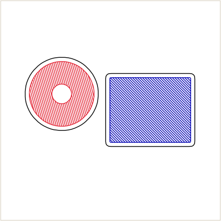

# Image tracing

Turn a logo, a drawing or a photo into pen strokes. You can also add an offset cut line, for example
for stickers.

## Getting started

1. Under **Source › Subject**, choose **Image**, then click **Open image…** in the **Image** section. PNG,
   JPG, BMP, GIF, TIFF and WebP all work. Transparent areas count as paper.
2. The picture is traced straight away and placed in the middle of the sheet. **Trace Image** re-traces
   it. Changing any setting re-traces automatically after a short pause.
3. Each traced colour gets its own layer and pen. Change them in the table at the bottom of the
   section, or **right-click the layer** in the Layers panel.
4. Export as usual. Choose **Save SVG** for cutting software or **Export G-code** for the plotter.

## Methods

### Outlines (logos, clip-art)

Best for flat-colour artwork: logos, icons, line drawings, and anything with clean edges.

- **Colours (incl. background)**: the image is reduced to this many colours. The colour that touches the
  border most is treated as the background and is not drawn. Every other colour becomes a layer of
  smooth, closed outlines.
  - **2** gives a black-and-white trace split at the best brightness threshold. **Trace the light parts
    instead** inverts it for light artwork on a dark background.
  - **3–8** separates the colours of the artwork.
- **Smoothing** rounds off jagged pixel edges. Higher values give smoother curves with less fine detail.
  **Sharp** keeps the pixel outline.
- **Ignore specks under** drops tiny shapes caused by dust, JPEG noise or anti-aliasing.
- **Fill shapes with hatching** fills each colour with parallel lines at the **Hatch spacing** you set.
  Each colour uses a different angle.
- **Sticker cut line around the design** adds one closed outline around the whole design, at **Cut line
  offset** from it. Holes inside the design are ignored, so it is a single cuttable shape. Shapes that
  are further apart than twice the offset get separate outlines.

Pens are pre-selected to the nearest colour you have in stock. If an artwork colour is about the same as
your paper, it gets a contrasting pen. The cut line defaults to the pen with the most contrast against
the paper. The **Cutter Blade** tool pen is also offered for it.

### Edges (photos)

Draws the strongest edges in a photo as single lines, using Canny-style edge detection. **Edge detail**
controls how many weaker edges are kept. The result is a sketch rather than a faithful trace. Photos
with clear subjects and plain backgrounds work best.

## Size and placement

**Size on the page** scales the design down from "fit the sheet" (100%, with a 6 mm margin). The design
is always centred and keeps its proportions. The page size and orientation come from the **Paper**
section.

## Tips for good traces

- Start from the largest, cleanest version of the artwork you have. Images are processed at up to 1400 px
  on the long side.
- A PNG with a transparent background is ideal. With a JPEG, raise **Ignore specks** to remove
  compression noise.
- For stickers, plot the design first, then cut along the cut line, by hand or with a cutter. For laser
  or vinyl cutters, **Save SVG** with only the cut-line layer visible. Hidden layers are left out of
  exports.
- Fine outlines are exported without vpype's length filter, so small details such as dots on letters
  aren't lost.
