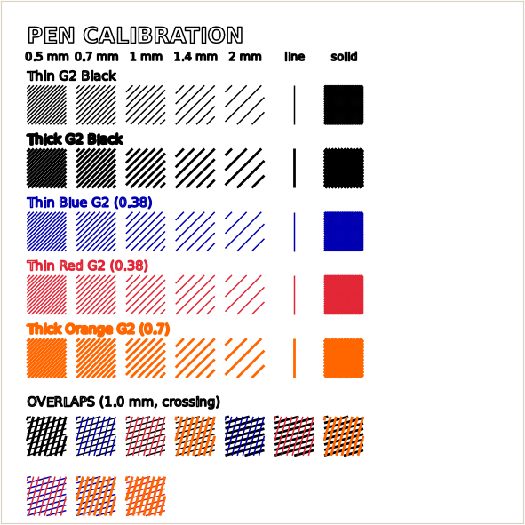

# Pens and paper

The app knows which pens you own, what colour and width they are, how transparent the ink is, and
whether each one still has ink. It uses this to choose inks for colour fills, to preview the plot
realistically, and to warn you when a pen won't show on your paper.

## The pen manager

Open it with **Tools › Pens…** or the **Pens…** button under the preview. Each row is one pen:

| Column | Meaning |
|---|---|
| **Cal.** | Include this pen in the next calibration sheet |
| **In stock** | Untick a pen when it runs dry or breaks. It disappears from every pen list and from colour fills, but stays in the table for when you replace it. |
| **Name** / **Colour** | What the pen is called and what its ink looks like. Click the colour to change it. |
| **Tip (mm)** | The pen's nominal tip size |
| **Line width (mm)** | The width of a stroke as measured on paper. Gel ink often draws wider than the tip. Leave it at "= tip" to use the tip size. |
| **Opacity** | 0 = transparent ink: colours mix like filters, and dark paper shows through. 1 = covers the paper and the ink below. Opaque white gel pens are about 0.85. Ordinary gel and ballpoint ink is close to 0. |
| **Feed (mm/min)** | This pen's drawing speed. Slow it down for thick or skipping pens. |
| **ID** | Internal key, used in project files |

**Add pen**, **Remove selected** and **Restore built-in pens** do what they say. Pens are saved in
`MoonPlotter/plotter_pens.json`.

The built-in set covers Pilot G2 gel pens (0.38 mm black, blue and red; 0.7 mm black, pink, orange, cyan,
blue, red, green, yellow and purple), Sakura Gelly Roll opaque white in 05, 08 and 10, and a **Cutter
Blade** tool pen. Edit the list to match what you own.

## Calibration sheet

**Tools › Pen calibration sheet…** opens the pen manager. Tick the pens in the **Cal.** column and click
**Make calibration sheet for checked pens**. The preview is replaced with a test sheet. For each ticked
pen it draws:

- hatch patches at 0.5, 0.7, 1, 1.4 and 2 mm spacing,
- a single-line width test,
- a near-solid swatch,
- an overlap patch for each pair of pens.

Plot it on the paper you'll use. Then measure the single line and enter it as **Line width**, and match
**Colour** to the solid swatch. The overlap patches show how two inks combine. Better numbers here make
the colour fills and the preview more accurate. Draw the map again to leave calibration mode.

## Colour fills

With **Fill / Hatching › Inks = Color separation**, tick the pens you want to use under **Inks to use**.
Click **All** to use every pen in stock, or pick a smaller set for a simpler plot.

For each colour in the map, the app searches combinations of up to three of your inks. It uses each
ink's colour, opacity and line width to predict the colour on your paper, and picks the mix that matches
best. It then hatches each ink at its own angle, so the layers cross instead of merging. Two pens with
the same ink colour (a 0.38 and a 0.7 black, for example) are treated as one, and the wider one is used.

The preview switches to an **ink simulation**: each pen is rendered at its real width and opacity on top
of the paper colour, lightest ink first. This is how the app plots them, too.

## Paper colour

Set **Paper › Paper colour** to the sheet you're using: white, black, cream/ivory, tan/kraft, greys, the
usual construction-paper colours, or a custom colour.

- **On light paper**, inks darken the paper, so a light area is plotted as sparse or no lines.
- **On dark paper**, only light, opaque inks show. White gel pens build up light tones, and the dark
  paper itself provides the shadows. Colour fills plan for this automatically.
- If a contour, index, border or water pen has too little contrast with the paper, a warning appears in
  the Contours section. On dark paper, its **Use light pens** button switches the contour pens to your
  lightest in-stock pens. Solar System mode has its own
  **Use light pens (dark paper)** button.

## Tips

- Gel pens skip if they move too fast or start moving before the ink flows. Lower the pen's **Feed**, and
  use **Settle after each pen-down** in the export dialog.
- Thick pens on fine hatching fill in solid. Increase **Line / dot spacing**, or move **Tone** lighter.
- Ink spreads into absorbent paper. Smooth, heavier paper, around 65 lb cover or heavier, keeps lines
  crisp.
